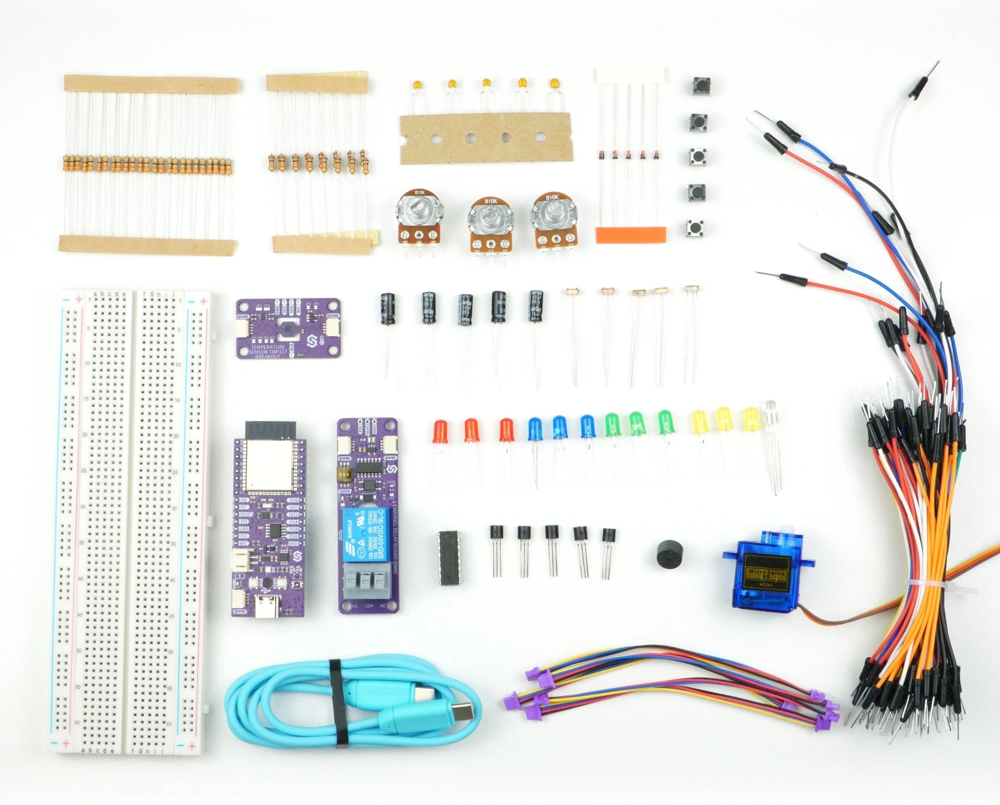

# Inventor kit: MicroPython examples

MicroPython example scripts for the Soldered Inventor kit, built around the
[NULA DeepSleep ESP32-S3](https://soldered.com/product/nula-deepsleep-esp32-s3-board/).

In these examples the board measures its own circuits. Example 1.1 reads the voltage across the resistor in series
with an LED, then works out the LED's forward voltage and the current through it. Example 3.1 captures a capacitor
charging and prints the time constant it measured beside the one it calculated. Example 4.2 finds the two pulse
widths your servo actually stops at, which will not be the ones written in the file.

Every number the scripts print comes from your parts, not from a datasheet.

These are the same 21 examples as the
[Arduino repository](https://github.com/SolderedElectronics/Soldered-NULA-Inventor-kit-Arduino-project-examples),
with matching numbering and matching pins.

## What is on the board

An ESP32-S3 with a CH340 USB-serial chip, an onboard WS2812B RGB LED, a PCF85063A real-time clock and a Qwiic
connector. Deep-sleep current is in the single microamps.

There are 21 examples across eight sections. Sections 0 to 4 stay on the breadboard and use the ADC to measure
resistors, capacitors, diodes and transistors. Sections 5 and 6 add the Qwiic modules and deep sleep, and 6.2 hands
the threshold to the sensor so the board only wakes to ask whether anything happened. Section 7 combines the lot
into four projects, none of which blocks.

## Getting started

### 1. Flash MicroPython

Download the **ESP32-S3** build from [micropython.org/download/ESP32_GENERIC_S3](https://micropython.org/download/ESP32_GENERIC_S3/)
and write it to the board with `esptool`:

```
esptool.py --chip esp32s3 --port COM7 erase_flash
esptool.py --chip esp32s3 --port COM7 write_flash -z 0 ESP32_GENERIC_S3-<version>.bin
```

Replace `COM7` with your own port. On macOS and Linux it looks like `/dev/ttyUSB0` or `/dev/cu.usbserial-*`.

### 2. Install the CH340 driver

The USB-C port runs through a CH340. Without its driver the board never appears as a serial port, so there is
nothing for `esptool` or Thonny to talk to. Windows and macOS both need it; on Linux it is already in the kernel.

Driver and troubleshooting: [docs.soldered.com/ch340-drivers](https://docs.soldered.com/ch340-drivers)

### 3. Copy the lib folder onto the board

Sections 5 to 7 import drivers that are not part of MicroPython. Copy the whole `lib` folder from this repository
to the root of the board's filesystem, which is where `import` looks by default.

| Driver | Used by | Source |
| --- | --- | --- |
| `tmp117.py` | 5.1, 6.2, 7.1, 7.2, 7.4 | [Soldered TMP117 MicroPython library](https://github.com/SolderedElectronics/Soldered-TMP117-MicroPython-Library) |
| `Relay.py` | 5.2, 7.1, 7.4 | [Soldered Relay MicroPython library](https://github.com/SolderedElectronics/Soldered-Relay-MicroPython-Library) |
| `pcf85063a.py` | 6.1, 7.2 | [Soldered PCF85063A MicroPython library](https://github.com/SolderedElectronics/Soldered-PCF85063A-MicroPython-Library) |

They are copied here unchanged so a fresh board needs one drag rather than three downloads. Sections 0 to 4 import
nothing beyond the standard library.

Example 7.2 also needs `urequests`, which is not bundled with every build. Install it from the console with
`import mip; mip.install("urequests")`.

### 4. Run an example

Each example lives in its own folder. Open the `.py` file in Thonny and press Run, or copy it to the board as
`main.py` if you want it to start on power-up.

Most scripts have a `MODE` constant near the top. Each mode is one step of the same lesson, usually with a rewiring
in between, so work through them in order instead of running once.

## The examples

### 0. Getting started

| Example | What you learn | Hardware |
| --- | --- | --- |
| [0.1 First blink](0_Getting_Started/0.1_First_Blink) | That the board, the driver and MicroPython all work, before anything harder | LED, 330 Ω resistor |
| [0.2 Reading a potentiometer](0_Getting_Started/0.2_Reading_A_Potentiometer) | Analog reads in counts and in millivolts, and two traces at once on the plotter | Potentiometer |

### 1. LEDs and PWM

| Example | What you learn | Hardware |
| --- | --- | --- |
| [1.1 LED current and resistor sizing](1_LEDs_And_PWM/1.1_LED_Current_And_Resistor_Sizing) | Forward voltage and current measured from your own LED, and where the number 330 comes from | LED, 330 Ω resistor, 10 kΩ resistor |
| [1.2 Gamma fading and RGB colour mixing](1_LEDs_And_PWM/1.2_Gamma_Fading_And_RGB_Colour_Mixing) | Hardware PWM, why duty cycle is not brightness, and the difference between driving an LED and messaging one | LED, 330 Ω resistor, potentiometer, onboard WS2812B |

### 2. Buttons and analog inputs

| Example | What you learn | Hardware |
| --- | --- | --- |
| [2.1 Pull-up resistors and button debouncing](2_Buttons_And_Analog_Inputs/2.1_Pull_Up_Resistors_And_Button_Debouncing) | Floating pins, pull-up against pull-down, the internal pull-up, and your button's real bounce duration | 2× pushbuttons, 3× 10 kΩ resistors, 100 nF capacitor, LED, 330 Ω resistor |
| [2.2 ADC noise, averaging and calibration](2_Buttons_And_Analog_Inputs/2.2_ADC_Noise_Averaging_And_Calibration) | That a reading is an estimate with a spread, what averaging costs, and the limit averaging cannot pass | Potentiometer |
| [2.3 Photoresistor divider with hysteresis](2_Buttons_And_Analog_Inputs/2.3_Photoresistor_Divider_With_Hysteresis) | Picking a component value from a measurement, and why one threshold is unstable | Photoresistor, 3× 10 kΩ resistors, LED, 330 Ω resistor |

### 3. Capacitors, diodes and transistors

| Example | What you learn | Hardware |
| --- | --- | --- |
| [3.1 Measuring an RC time constant](3_Capacitors_Diodes_And_Transistors/3.1_Measuring_An_RC_Time_Constant) | That the formula is arithmetic you can verify, and how to tell an untrustworthy measurement from a disappointing one | 2× 10 kΩ resistors, 100 nF capacitor, 10 µF capacitor, pushbutton |
| [3.2 Diode forward voltage](3_Capacitors_Diodes_And_Transistors/3.2_Diode_Forward_Voltage) | That 0.7 V is the middle of a range, and how to spot a reading the ADC has clipped | 1N4148 diode, 330 Ω resistor, potentiometer |
| [3.3 Transistor base resistor and saturation](3_Capacitors_Diodes_And_Transistors/3.3_Transistor_Base_Resistor_And_Saturation) | That a transistor is a current amplifier, what saturation is, and how to size a base resistor | NPN transistor, 10 kΩ resistor, LED, 330 Ω resistor, potentiometer |

### 4. Shift register and actuators

| Example | What you learn | Hardware |
| --- | --- | --- |
| [4.1 Eight LEDs from three pins](4_Shift_Register_And_Actuators/4.1_Eight_LEDs_From_Three_Pins) | How a shift register moves data, what hardware SPI buys you over pin writes, and what a latch is for | SN74HC595N shift register, 8× LEDs, 8× 330 Ω resistors, 100 nF capacitor, potentiometer |
| [4.2 Servo pulses without a library](4_Shift_Register_And_Actuators/4.2_Servo_Pulses_Without_A_Library) | What a servo signal actually is, that parts are not identical, rate limiting, and why a motor gets its own capacitors | SG90 servo, potentiometer, 10 µF capacitor, 100 nF capacitor |
| [4.3 Driving a buzzer through a transistor](4_Shift_Register_And_Actuators/4.3_Driving_A_Buzzer_Through_A_Transistor) | Why a passive buzzer needs an alternating signal, mechanical resonance, and what a flyback diode is for | Buzzer, NPN transistor, 10 kΩ resistor, 1N4148 diode, potentiometer |

### 5. Qwiic modules

| Example | What you learn | Hardware |
| --- | --- | --- |
| [5.1 Scanning the bus and reading temperature](5_Qwiic_Modules/5.1_Scanning_The_Bus_And_Reading_Temperature) | What is really on the I2C bus, and how to tell a reading from a number a missing sensor handed back | TMP117 temperature sensor, Qwiic cable |
| [5.2 Relay switching with hysteresis and lockout](5_Qwiic_Modules/5.2_Relay_Switching_With_Hysteresis_And_Lockout) | That a mechanical output needs rules a logic output does not, and separating what you want from what you may do | Qwiic relay, Qwiic cable, potentiometer, LED, 330 Ω resistor |

### 6. Low power

| Example | What you learn | Hardware |
| --- | --- | --- |
| [6.1 Deep sleep, wake sources and RTC memory](6_Low_Power/6.1_Deep_Sleep_Wake_Sources_And_RTC_Memory) | That deep sleep is stopping and starting, not pausing, and that an interval and a schedule are different things | Pushbutton, 10 kΩ resistor, LED, 330 Ω resistor |
| [6.2 Checking a sensor alert flag](6_Low_Power/6.2_Checking_A_Sensor_Alert_Flag) | That the sensor can hold the threshold and decide when the processor is needed, and what a wake costs when it finds nothing | TMP117 temperature sensor, Qwiic cable, LED, 330 Ω resistor |

### 7. Projects

| Project | What it combines | Hardware |
| --- | --- | --- |
| [7.1 Thermostat with relay and alarm](7_Projects/7.1_Thermostat_With_Relay_And_Alarm) | Sensor, relay, pot, LED and buzzer in one non-blocking loop with a run-on timer | TMP117 temperature sensor, Qwiic relay, potentiometer, buzzer, NPN transistor, LED |
| [7.2 Wi-Fi temperature logger](7_Projects/7.2_WiFi_Temperature_Logger) | Deep sleep, RTC alarms, a buffer that survives sleep, and where the energy in a connected device goes | TMP117 temperature sensor, pushbutton, 10 kΩ resistor |
| [7.3 Two-sensor sun tracker](7_Projects/7.3_Two_Sensor_Sun_Tracker) | Closed-loop control taught through its failure: dead band, rate limit and per-sensor calibration | 2× photoresistors, servo, SN74HC595N shift register, 8× LEDs |
| [7.4 Bench controller](7_Projects/7.4_Bench_Controller) | Architecture. Five jobs at three different rates, none of which blocks | Most of the kit |

## Pins

| Purpose | Pin | Notes |
| --- | --- | --- |
| Single LED | IO38 | Always through its own 330 Ω resistor |
| Analog inputs | IO4, IO5, IO6, IO7 | Pots, photoresistors and circuit taps |
| Wake-capable button | IO21 | The only button that can wake the board from deep sleep |
| Other buttons | IO39, IO40, IO41, IO42 | |
| Shift register | IO11 data, IO12 clock, IO10 latch, IO13 output enable | IO11 and IO12 are also hardware SPI MOSI and SCK |
| Servo signal | IO47 | Power from VCC, never 3V3 |
| Buzzer, through the transistor | IO48 | |
| Qwiic / I2C | IO8 SDA, IO9 SCL | Passed to `I2C(0, scl=Pin(9), sda=Pin(8))` in every example that needs it |

Two more are wired on the board itself and need nothing from you: the WS2812B RGB LED is on **IO2** through a 1 kΩ
series resistor, and the PCF85063A RTC's interrupt output is on **IO17**, already pulled up to 3V3. Neither is
brought out to a header.

### Pins to leave alone

| Pin | Why |
| --- | --- |
| IO43, IO44 | UART0, the serial console |
| IO0 | Boot strap pin, and the onboard USER button |
| IO2 | The onboard WS2812B RGB LED, not brought out to a header |

IO19 and IO20 are the ESP32-S3's native USB lines, but this board talks to your computer through the CH340,
so nothing uses them and they are free for your own circuits.

### Why every analog pin is IO4 to IO10

The ESP32-S3 has two ADCs, and ADC2 shares hardware with the radio. Once Wi-Fi starts, a read on an ADC2 pin stops
returning anything useful, and on this board IO11 upwards are ADC2. Section 7 turns Wi-Fi on, so every analog input
in this kit stays on ADC1. IO8 and IO9 are ADC1 as well but belong to the Qwiic bus, which leaves IO4, IO5, IO6,
IO7 and IO10.

### Buttons and pull-ups

Buttons use the chip's **internal pull-up resistors**, switched on with `Pin.PULL_UP`, so no resistor is needed on
the breadboard: one side to the pin, the other straight to GND. The readings come out the other way round from what
you might expect, which is called active low: the pin reads **1 while released** and **0 while pressed**.

The exception is any button that has to wake the board from deep sleep. The internal pull-ups switch off during
sleep, so those need a **10 kΩ to 3V3** on the breadboard as well, or the pin floats and wakes the board at random.

## What is different from the Arduino version

The circuits and the pins are identical. The code is not, and four differences are worth knowing before you compare
the two side by side.

| | Arduino | MicroPython |
| --- | --- | --- |
| A missing Qwiic module | The driver returns `0.0000 °C` and nothing looks wrong | The read raises `OSError`, so the examples catch it |
| Servo pulse width | Converted into an LEDC duty number, capped at 14 bits | `PWM.duty_ns()` takes the pulse width directly |
| State that survives deep sleep | `RTC_DATA_ATTR` on each variable | Packed into `machine.RTC().memory()` with `struct` |
| Getting a byte into the 74HC595 | Three ways: pin writes, `shiftOut()`, hardware SPI | Two: pin writes and hardware SPI. There is no `shiftOut()` |

Both still check `getDeviceID() == 0x117` before trusting a temperature. Catching the exception only tells you the
bus answered, not that the right device answered.

## Constants to measure for yourself

`RESONANT_HZ` in 4.3 and the servo pulse limits in 4.2 are starting values, not answers. Measure your own on the
pages that teach you how, then carry them into 7.1, 7.3 and 7.4.

### About Soldered


At Soldered, we design and manufacture a wide selection of electronic products to help you turn your ideas into acts and bring you one step closer to your final project. Our products are intented for makers and crafted in-house by our experienced team in Osijek, Croatia. We believe that sharing is a crucial element for improvement and innovation, and we work hard to stay connected with all our makers regardless of their skill or experience level. Therefore, all our products are open-source. Finally, we always have your back. If you face any problem concerning either your shopping experience or your electronics project, our team will help you deal with it, offering efficient customer service and cost-free technical support anytime. Some of those might be useful for you:

- [Web Store](https://www.soldered.com/shop)
- [Tutorials & Projects](https://soldered.com/learn)
- [Documentation](https://docs.soldered.com)
